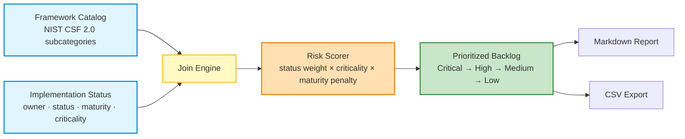

# 🧭 NIST CSF 2.0 Control Gap Analyzer

[](https://github.com/Mihirajmera/control-gap-analyzer/actions/workflows/python-ci.yml)
[](https://github.com/Mihirajmera/control-gap-analyzer/actions/workflows/codeql.yml)
[](https://scorecard.dev/viewer/?uri=github.com/Mihirajmera/control-gap-analyzer)
[](https://github.com/Mihirajmera/control-gap-analyzer/releases)
[](https://www.python.org/)
[](LICENSE)

A Python tool that joins an organization's control implementation status against the
**NIST CSF 2.0** subcategory catalog, risk-scores every gap by status × maturity ×
criticality, and produces a prioritized remediation backlog — the same exercise a GRC
team runs manually in ServiceNow GRC / RSA Archer during a compliance gap analysis,
automated and reproducible.

## Why this exists

Technology risk assessments and control gap analysis usually mean manually cross-walking
a spreadsheet of "what's implemented" against a framework's control catalog, then arguing
about what to prioritize. This tool makes that mapping deterministic: feed it a catalog
and an implementation status export, and it tells you exactly which controls are open
gaps, how severe each one is, and in what order to remediate them.

## How it works



## Risk scoring model

Transparent by design — no black box:

| Factor | Weighting |
|---|---|
| Implementation status | Not Implemented / Not Assessed = 3, Partial = 2, Implemented = 0 |
| Criticality | High = 3, Medium = 2, Low = 1 |
| Maturity penalty | `(5 - maturity_level) / 5` — low-maturity controls score higher risk |

`risk_score = status_weight × criticality_weight × (1 + maturity_penalty)`

Scores ≥12 are **Critical**, ≥7 **High**, ≥3 **Medium**, >0 **Low**. Adjust the weights in
`gap_analyzer/scorer.py` to match your organization's risk appetite.

## Installation & Quick Start

You can install the tool locally as a package:

```bash
pip install -e .
```

Once installed, run it using the `control-gap-analyzer` CLI command:

```bash
# Run with default synthetic sample data
control-gap-analyzer
```

This runs against the included synthetic sample data (`data/nist_csf2_catalog.csv` +
`data/sample_control_implementation.csv`) and writes:
- `reports/gap_report.md` — executive summary + prioritized remediation backlog
- `reports/gap_report.csv` — full scored control list for further analysis in Excel/Power BI

Run against your own data:

```bash
python cli.py --catalog data/nist_csf2_catalog.csv \
               --implementation path/to/your_control_status.csv \
               --out-md reports/gap_report.md \
               --out-csv reports/gap_report.csv
```

## Sample output

> **30 controls assessed — 16 open gaps (1 critical)**

| Priority | Subcategory | Description | Owner | Status | Risk Score |
|---|---|---|---|---|---|
| 🔴 Critical | `DE.AE-02` | Adverse events are analyzed to understand associated activities | SOC | Not Implemented | 16.2 |
| 🟠 High | `GV.OV-01` | Risk management strategy outcomes are reviewed | Executive Leadership | Not Implemented | 10.8 |
| 🟠 High | `RS.CO-02` | Stakeholders are notified of incidents | Incident Response | Not Implemented | 10.8 |

Full report: [`reports/gap_report.md`](reports/gap_report.md)

## Project structure

```
control-gap-analyzer/
├── cli.py                              # entry point
├── gap_analyzer/
│   ├── catalog.py                      # loads + joins catalog with implementation status
│   ├── scorer.py                       # risk scoring model
│   └── report.py                       # Markdown + CSV report generation
├── data/
│   ├── nist_csf2_catalog.csv           # NIST CSF 2.0 functions/categories/subcategories
│   └── sample_control_implementation.csv  # synthetic sample org data
├── reports/                            # generated output (gitignored except sample)
└── tests/
    └── test_scorer.py
```

## 🤖 CI/CD & Testing

This project uses `pytest` for testing, and is configured with automated CI/CD checks:
- **CI/CD Pipeline**: A GitHub Actions workflow (`.github/workflows/python-ci.yml`) runs automatically on push/pull requests to check code style (`flake8`), run security scans (`bandit`), and execute tests (`pytest`).

To install development dependencies and run tests locally:

```bash
pip install -e .[dev]
pytest
```

## Roadmap

- [ ] Add SP 800-53 Rev 5 and PCI-DSS v4.0 catalogs alongside NIST CSF 2.0
- [ ] ServiceNow GRC / RSA Archer CSV export format adapters
- [ ] Trend view across multiple assessment snapshots (control maturity over time)
- [ ] HTML report with charts (currently Markdown/CSV only)

## About

Built by [Mihir Ajmera](https://linkedin.com/in/mihirajmera) — GRC Engineer specializing
in technology risk assessments, NIST CSF 2.0 / SP 800-53 control testing, and compliance
automation.
